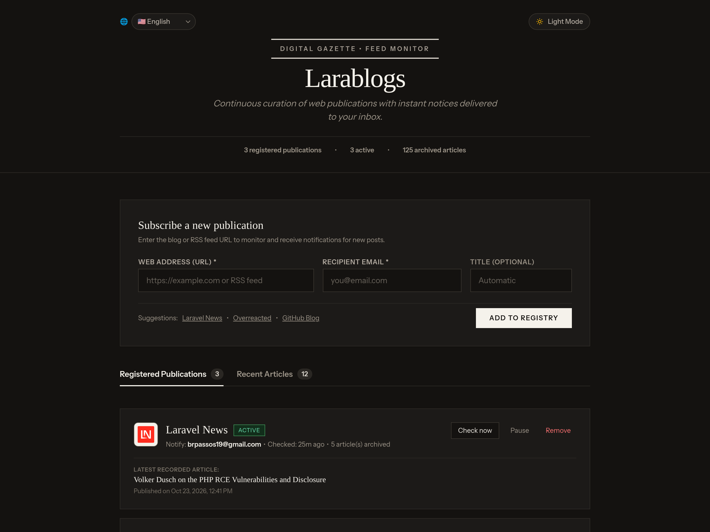
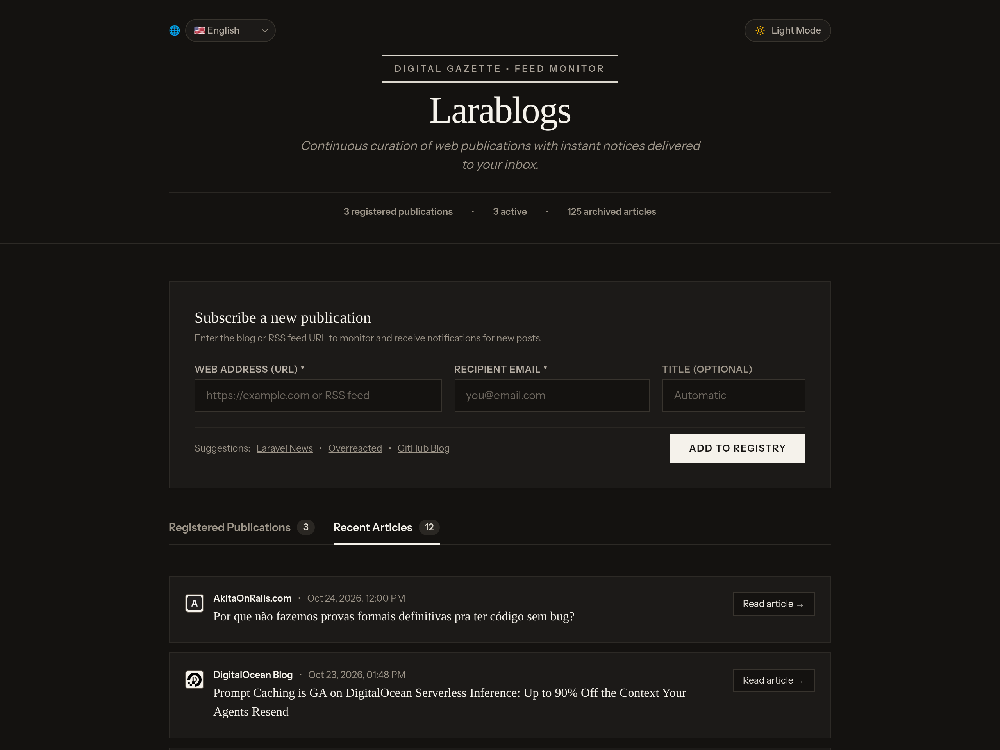
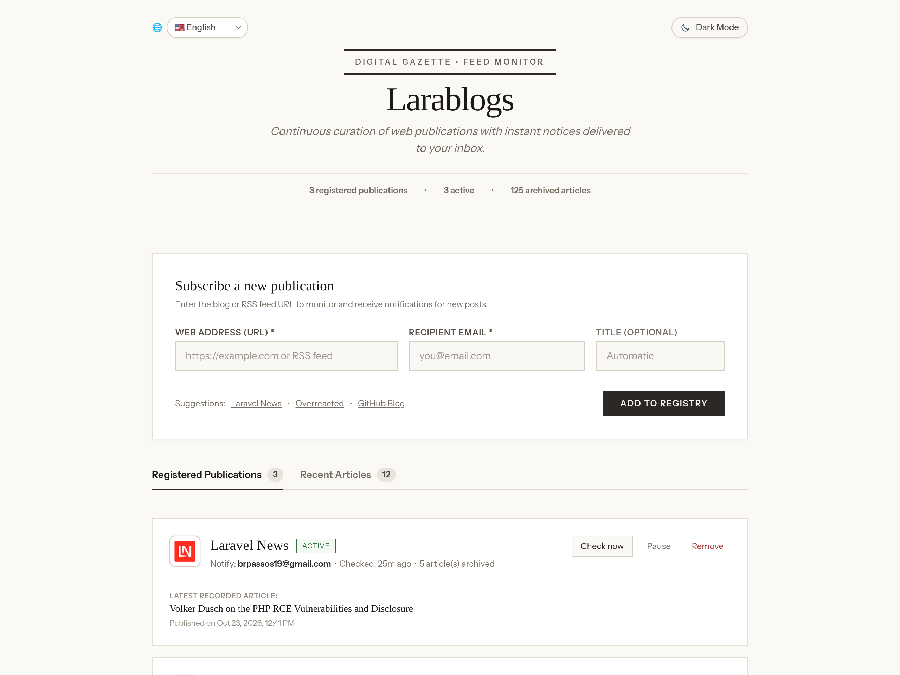

<p align="center">
  
</p>
<h1 align="center">Larablogs</h1>
<p align="center"><strong>Curadoria contínua e radar pessoal de blogs com notificações instantâneas.</strong></p>
<p align="center">
  <a href="#o-que-você-pode-fazer">Recursos</a> ·
  <a href="#telas-do-projeto">Capturas de tela</a> ·
  <a href="#instalação">Instalação</a> ·
  <a href="#verificação-em-segundo-plano">Background Scheduler</a> ·
  <a href="#stack-e-requisitos">Stack</a> ·
  <a href="#testes">Testes</a>
</p>

Um monitor pessoal de publicações da web construído com **PHP 8.5, Laravel 13, Vue.js 3, Inertia.js e Tailwind CSS v4**.
Basta colar a URL de qualquer blog ou feed RSS para acompanhar novas postagens e receber alertas instantâneos no seu e-mail, com linha de base anti-spam e uma interface editorial serena com suporte a múltiplos idiomas e temas.

---

## Telas do projeto

<p align="center">
  
</p>

*Tema Escuro padrão (Editorial Midnight) — tipografia clássica, selos de alto contraste para favicons escuros e controle de verificação.*

<p align="center">
  
</p>

*Aba de Artigos Recentes — identificação visual imediata pelo favicon do blog de origem e status de notificação enviada.*

<p align="center">
  
</p>

*Tema Claro alternativo no estilo tradicional de folhetim e papel marfim.*

---

## O que você pode fazer

| Recurso | No Larablogs |
|---|---|
| **Descoberta Inteligente** | Insira apenas a URL principal do blog (ex.: `https://laravel-news.com`); o sistema localiza automaticamente as tags RSS/Atom no HTML ou rotas comuns (`/feed`, `/rss`, `/atom.xml`). |
| **Linha de Base Anti-Spam** | Ao cadastrar um blog, os artigos já existentes são arquivados como baseline sem disparar e-mails retroativos. Apenas novos artigos após o cadastro geram alertas. |
| **Design Editorial** | Tipografia clássica de jornal e boletim periódico com modo escuro nativo (*Midnight Editorial*) e alternância instantânea para modo claro com persistência em `localStorage`. |
| **Selos de Alto Contraste** | Molduras de alto contraste para logotipos e favicons garantem nitidez mesmo quando o ícone do site for preto ou tiver fundo transparente. |
| **Multi-idioma (i18n)** | Suporte completo a 5 idiomas no cabeçalho: 🇧🇷 Português, 🇺🇸 English, 🇪🇸 Español, 🇫🇷 Français e 🇩🇪 Deutsch, com datas e tempos relativos formatados de acordo com o idioma. |
| **Notificação Direta (Zero-Queue)** | Envio síncrono das notificações por e-mail no próprio processo da checagem, sem necessidade obrigatória de workers ou filas adicionais. |
| **Controle Individual** | Verificação sob demanda via botão (*Check now*), pausa/retomada de monitoramento e exclusão com confirmação. |

---

## Stack e requisitos

- **PHP**: 8.5.x
- **Node.js**: 24.x
- **Laravel**: 13.x
- **Frontend**: Vue.js 3, Inertia.js 3, Tailwind CSS v4, Vite
- **Banco de Dados**: SQLite (zero-config, em `database/database.sqlite`)
- **Versionamento de Runtime**: `mise` (`mise.toml`)

---

## Instalação

### 1. Clonar o repositório
```sh
git clone git@github.com:bcosta19/larablogs.git
cd larablogs
```

### 2. Instalar dependências
```sh
composer install
npm install
```

### 3. Configurar ambiente e banco de dados
```sh
cp .env.example .env
php artisan key:generate
touch database/database.sqlite
php artisan migrate
```

### 4. Executar em desenvolvimento
```sh
composer run dev
```
*(ou separadamente em dois terminais: `php artisan serve` e `npm run dev`)*

Abra no navegador em: **`http://localhost:8000`**

---

## Verificação em segundo plano

O comando Artisan responsável por varrer os feeds cadastrados e disparar os alertas é o:
```sh
php artisan blogs:check
```

Para manter o agendador nativo do Laravel escutando em desenvolvimento:
```sh
php artisan schedule:work
```

Para produção ou execução contínua no Linux, basta uma única linha no seu crontab (`crontab -e`):
```cron
* * * * * cd /caminho/para/larablogs && php artisan schedule:run >> /dev/null 2>&1
```

> **Dica de E-mail Local**: Por padrão, o Laravel utiliza `MAIL_MAILER=log`, gravando os e-mails disparados em `storage/logs/laravel.log`. Para visualizar os e-mails com interface web em desenvolvimento, aponte para um servidor [Mailpit](https://github.com/axllent/mailpit) na porta `1025` no seu `.env`.

---

## Testes

A aplicação inclui suite completa de testes de feature cobrindo a descoberta de feed, baseline, checagem, notificações e comandos CLI:

```sh
php artisan test
```

---

## Licença

Distribuído sob a licença [MIT](LICENSE).
